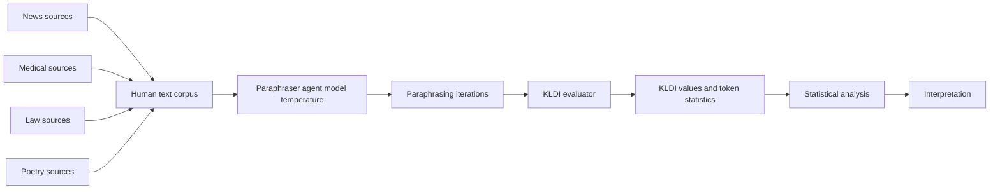
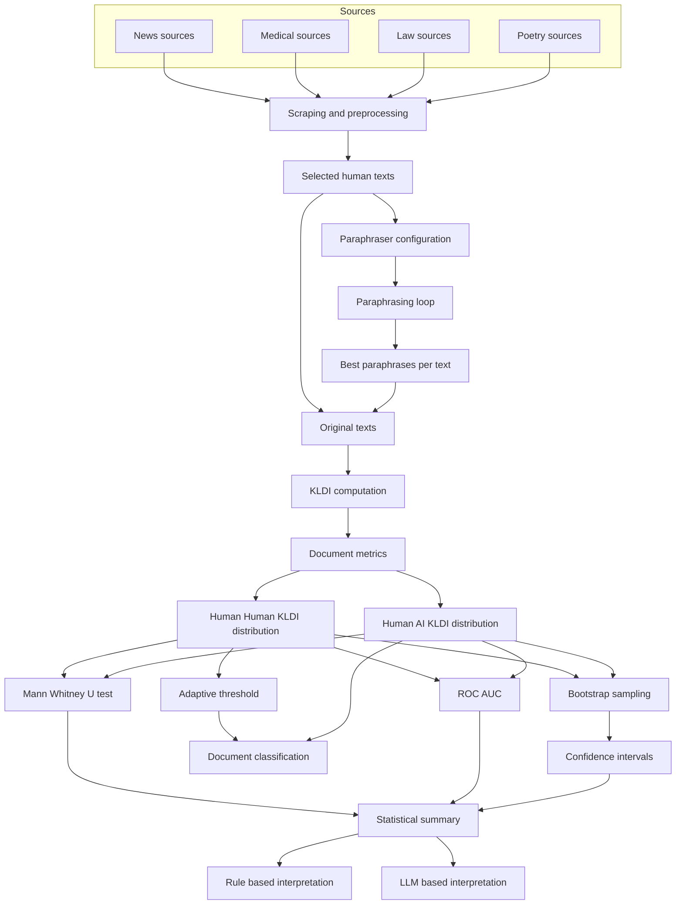
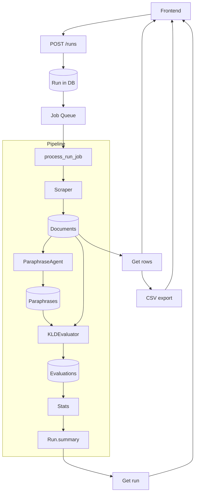
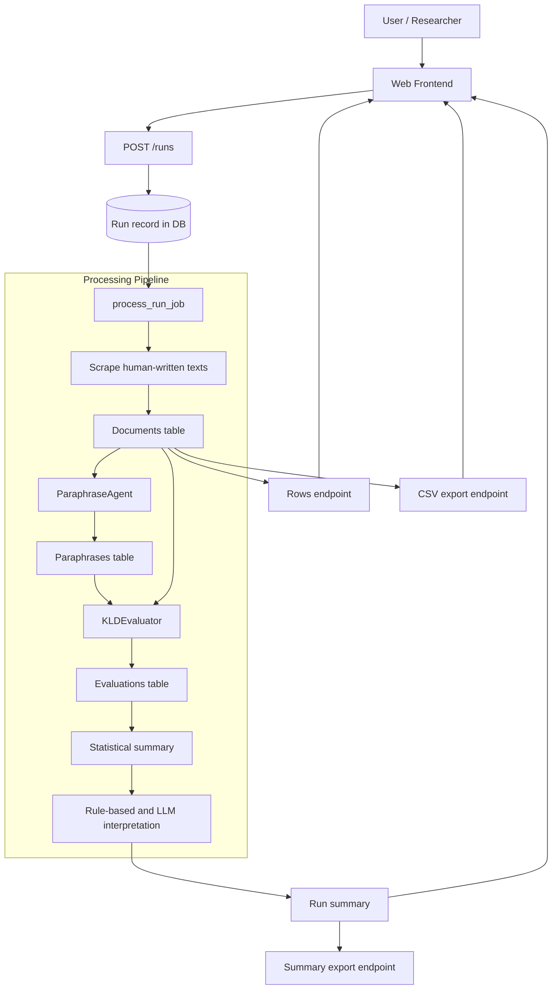
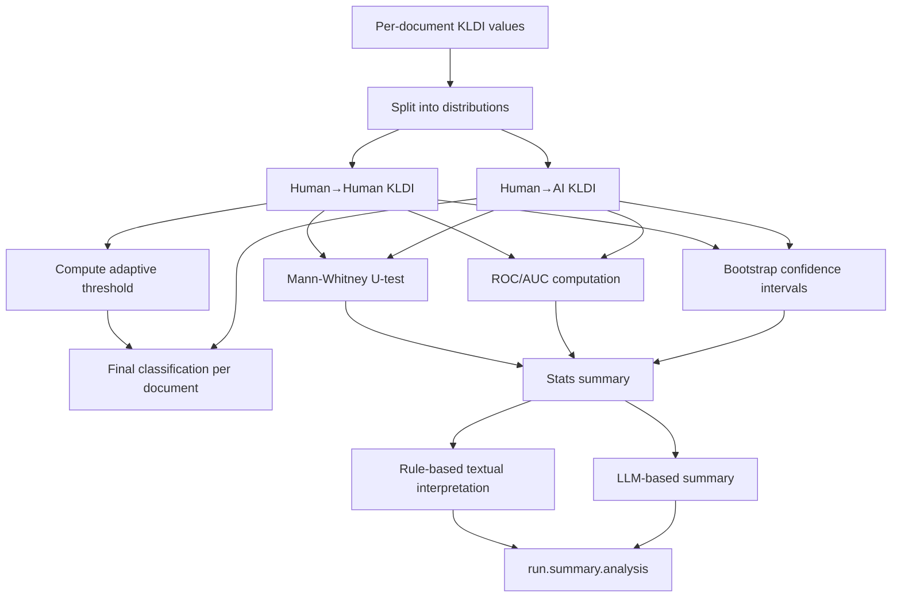
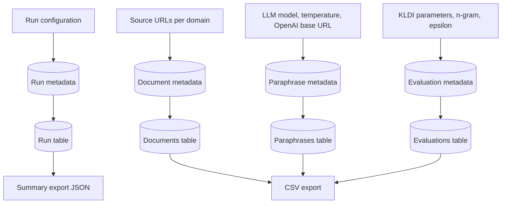

# Human-Like Text Paraphrasing System

> **Paper data:** The data, results and reproduction scripts for the paper *From Detection to Provenance* are in [`paper/`](paper/README.md).

This project implements a **multi-agent paraphrasing and evaluation system** designed to answer a central question:

> Can AI-generated paraphrases of human-written texts be reliably identified as AI text using the Kullback-Leibler Divergence Index (KLDI)?

The system:

- Scrapes pre-2019 **human-written texts** from four fixed domains (poetry, law, medicine/health, and news).
- Paraphrases them using an OpenAI-compatible LLM.
- Computes KLDI between original and paraphrased text.
- Builds **Human→Human** and **Human→AI** KLDI distributions.
- Performs statistical tests (Mann-Whitney-U, ROC/AUC) and derives an **adaptive threshold**.
- Presents results via a small web frontend (table + interpretation) and a CSV export.

Reproducibility and transparency are first-class goals: seeds, model versions, source URLs, and statistical summaries are persisted.

---

## Architecture

### 1. Multi-Agent Paraphrasing Core

Mermaid diagram of the high-level paraphrasing and evaluation flow:



Detailed deep-dive diagram of the same flow:



- **ParaphraseAgent** (`paraphrase_agents/agent.py`)
  - Wraps an OpenAI-compatible model configured through `.env` and `paraphrase_agents/config.py`.
  - Produces natural, human-like paraphrases while preserving meaning.

- **KLDEvaluator** (`paraphrase_agents/evaluator.py`)
  - Implements the theoretically defined KLDI:
    - Tokenization (NLTK, with optional n-grams)
    - Shared vocabulary for P (original) and Q (paraphrase)
    - Frequency distributions converted to probabilities
    - ε smoothing of Q: \( q'(x) = \frac{q(x) + \varepsilon}{1 + \varepsilon |X|} \)
    - Vectorized computation: \( D(P \| Q) = \sum_x p(x) \log_2 \frac{p(x)}{q(x)} \)

- **ParaphraseOrchestrator** (`paraphrase_agents/orchestrator.py`)
  - Invokes multiple agents with different styles.
  - Evaluates candidates using KLDI, length, and word overlap.
  - Optionally runs feedback loops to improve results.

### 2. Backend-Pipeline

Mermaid diagram of the end-to-end backend pipeline:



**Domains and sources** (`backend/domains.py`):

- **Poetry** – pre-2019 works from Project Gutenberg, such as Poe and Shakespeare.
- **Law** – constitutional texts and legal reference material.
- **Medicine/Health** – pre-2019 WHO and CDC publications.
- **News** – NASA news pages and archived BBC pages.

---

## Installation and Startup

### 1. Requirements

- Python 3.10+
- Redis, installed locally or provided through Docker
- Internet access for scraping and the LLM API

### 2. Create `.env`

Create a `.env` file in the project root (see `.env.example`):

```env
OPENAI_API_KEY=your_openai_api_key_here
OPENAI_MODEL=gpt-4.1
OPENAI_BASE_URL=https://api.openai.com/v1

# Optional: Git commit for code reproducibility
GIT_COMMIT=$(git rev-parse HEAD)
```

### 3. Startup Script

The `start.sh` script handles:

- Port checks and optional port cleanup for:
  - Backend: 8000
  - Frontend: 5500
- Creation and reuse of a local virtual environment (`.venv`).
- Installation of all Python dependencies.
- Optional Redis initialization when `redis-server` is available.
- Startup of:
  - **FastAPI** backend at `http://localhost:8000`
  - **RQ worker** for the job queue
  - **Static frontend server** at `http://localhost:5500`

Run it from the project root:

```bash
chmod +x start.sh
./start.sh
```

The console displays:

- The backend URL (`/docs` for Swagger UI)
- The frontend URL
- Information about running processes and how to stop them with `Ctrl+C`

---

## Frontend Usage

1. Open `http://localhost:5500/index.html` in a browser.
2. Enter a value such as `100` or `1000` in the **"Number of texts (1–2000)"** field.
3. Click **"Start analysis"**:
   - A new run is created through `POST /runs`.
   - The run ID is displayed.
   - The frontend polls `GET /runs/{id}` every five seconds.
4. Once the run reaches `COMPLETED`:
   - The table is populated through `GET /runs/{id}/rows`.
   - A CSV export is available through `GET /runs/{id}/export?format=csv`.

### UI Elements

- **Status badge**: displays `PENDING`, `RUNNING`, `COMPLETED`, or `FAILED`.
- **Interpretation** (frontend text box):
  - Uses `run.summary.analysis.interpretation`, for example:
    - "KLDI is high and the difference is significant: AI text is statistically detectable in this sample (significant, high AUC)."
    - "KLDI is predominantly low or the distributions overlap substantially: AI text cannot be reliably distinguished from human text using KLDI."
- **Run summary (JSON)**: displays the complete summary, including per-domain statistics and test results.
- **Table**:
  - Columns: `ID`, `Domain`, `Source`, `Original`, `Paraphrase`, `KLDI`, `Classification`.
  - Classification is based on the adaptive threshold described below.

---

## Statistical Evaluation and KLDI Logic

### 1. KLDI Computation (P ⟂ Q)

For each pair of original text P and paraphrase Q:

1. Tokenize with NLTK `word_tokenize`, optionally using n-grams.
2. Build the vocabulary `X = Tokens(P) ∪ Tokens(Q)`.
3. Convert frequencies into probability vectors:
   - `p(x) = count_P(x) / sum_x count_P(x)`
   - `q(x) = count_Q(x) / sum_x count_Q(x)`
4. Smooth the support of Q:
   - `q'(x) = (q(x) + eps) / (1 + eps * |X|)` with `eps ≈ 1e-10`.
5. Compute KLDI:
   - `D(P || Q) = sum_x p(x) * log2(p(x) / q'(x))`
   - The NumPy implementation is vectorized and only evaluates values where `p(x) > 0`.

### 2. Human→Human vs. Human→AI

After a run finishes, the system constructs two distributions:

- **Human→AI**: `D(P_human || Q_ai)` for all paraphrases.
- **Human→Human**: KLDI between random pairs of original texts from the same domain.

### 3. Adaptive Threshold

The Human→Human values are used to calculate:

- Quartiles Q1 and Q3, with IQR = Q3 − Q1.
- Adaptive threshold: `T_adaptive = Q3 + 1.5 * IQR`.

A paraphrase KLDI above `T_adaptive` is clearly above the typical human range.

### 4. Classification

Each evaluation receives one of the following final classifications:

- **"human-like"** when `D(P || Q) <= T_adaptive`.
- **"detectable"** when `D(P || Q) > T_adaptive`.

### 5. Significance Tests

- **Mann–Whitney U test** (Human→Human vs. Human→AI):
  - Null hypothesis: both distributions originate from the same distribution type.
  - Result: `mannwhitney_p` in `summary.stats`.

- **ROC/AUC**:
  - Labels: 0 for Human→Human and 1 for Human→AI.
  - Score: the corresponding KLDI value.
  - Result: `roc_auc` in `summary.stats`.

### 6. Evaluative Text Summary

- When `p < 0.05` and `AUC ≥ 0.7`:
  - "KLDI is high and the difference is significant: AI text is statistically detectable in this sample (significant, high AUC)."
- Otherwise:
  - "KLDI is predominantly low or the distributions overlap substantially: AI text cannot be reliably distinguished from human text using KLDI."

---

## Reproducibility and Transparency

### 1. Reproducibility Metadata

Each run stores:

- `llm_model` – model configured through `.env` or the application configuration.
- `temperature` – creativity parameter.
- `seed` – Python random seed used for scraping and snippets.
- `git_commit` – optional Git commit supplied through `GIT_COMMIT`.
- `requested_count`, `per_domain_count`.
- `summary` – KLDI distributions, adaptive threshold, tests, and interpretation.
- `documents`, `paraphrases`, `evaluations` – the complete text corpus.

This allows runs to be repeated under the same conditions and audited afterward.

### 2. Transparency

- **Open metrics**: KLDI, per-domain averages, Human→Human and Human→AI counts, p-values, and ROC/AUC are exposed in the summary.
- **Open texts**: Both inputs (originals) and outputs (paraphrases) are available in the database and CSV exports.
- **Open sources**: Every document record stores its `source_url`.

### 3. Quality and Limitations

- KLDI is **not** proof of authorship; it is a distribution-based similarity measure.
- Statistical tests can provide evidence through significance and discriminability, but not absolute certainty.
- Adversarial noise, style variation, and domain effects can influence results.

---

## End-to-End Evaluation Workflow (Mermaid)

The following diagrams summarize the full evaluation workflow for scientific transparency.

### 1. High-level experiment flow



In words, a single experiment run proceeds as follows:

1. **Configuration & triggering**
   - The researcher chooses the number of texts and (optionally) domains.
   - A `POST /runs` request creates a persistent `Run` record including model, temperature, seed and Git commit.
2. **Human text acquisition**
   - The backend scrapes pre‑2019 human‑written texts from fixed, documented sources (law, poetry, medical, news).
   - Each snippet is stored as a `Document` together with its domain and `source_url`.
3. **AI generation (paraphrasing)**
   - For every `Document`, the `ParaphraseAgent` calls an OpenAI‑compatible model multiple times and keeps the paraphrase with the lowest KLDI.
   - All model calls are logged indirectly via `Paraphrase` records (text, model, temperature).
4. **Per‑document evaluation**
   - For each (Original, Paraphrase) pair, the `KLDEvaluator` computes a KLDI value and additional token statistics.
   - Results are stored as `Evaluation` rows and later used for statistical analysis.
5. **Aggregation & statistics**
   - Once all requested documents are processed, the system computes Human→Human and Human→AI KLDI distributions, an adaptive threshold, statistical tests and effect sizes.
   - A rule‑based and an LLM‑based interpretation are added to `Run.summary`.
6. **Inspection & export**
   - The researcher can inspect the run via `GET /runs/{id}`, browse rows, and export both raw tables (CSV) and the full statistical summary (JSON).

### 2. Statistical evaluation workflow



The statistical pipeline includes the following steps:

1. **Construction of KLDI distributions**
   - Human→AI: one KLDI value per (Original, Paraphrase) pair.
   - Human→Human: KLDI values for pairs of original texts within the same domain.
2. **Adaptive thresholding**
   - From the Human→Human distribution, the system derives an adaptive threshold (upper whisker of a boxplot) to define "clearly above human range".
   - This avoids arbitrary fixed thresholds and respects domain‑specific variability.
3. **Hypothesis testing & discriminability**
   - Mann–Whitney U‑test compares Human→Human vs. Human→AI; the p‑value indicates whether the distributions differ significantly.
   - ROC/AUC quantifies how well KLDI can, in principle, discriminate between human and AI texts.
4. **Effect sizes and uncertainty**
   - Effect size (e.g. Cliff's delta) summarizes how strongly the distributions differ.
   - Bootstrap confidence intervals for AUC and median differences express statistical uncertainty based on the available sample.
5. **Document‑level classification**
   - Using the adaptive threshold, each paraphrase is classified as "human‑like" or "detectable".
   - Per‑domain summaries (counts, average KLDI, human‑like vs. detectable) are recorded.
6. **Textual interpretation**
   - A rule‑based layer translates the numerical results into a short, conservative statement (e.g. "no robust evidence that AI is detectable" when AUC is low or p is non‑significant).
   - The `AnalysisAgent` optionally adds an LLM‑generated summary that explicitly states whether AI is (not) detectable in this sample and how robust the claim is.

### 3. Reproducibility & metadata flow



This design is scientifically robust because:

- **Transparent data provenance** – Every document, paraphrase and evaluation is stored with its source URL, model configuration and run metadata.
- **Explicit separation of human vs. AI distributions** – Human→Human and Human→AI KLDI distributions are constructed and reported separately.
- **Adaptive, data‑driven thresholding** – The decision boundary is derived from human reference data instead of being chosen ad hoc.
- **Multiple statistical lenses** – Significance tests, AUC, effect sizes and confidence intervals jointly describe the strength and reliability of evidence.
- **Per‑domain reporting** – Domain‑wise counts and averages make it visible whether a result is driven by particular topics.
- **Full exportability** – Both raw data (CSV) and high‑level summaries (JSON) can be archived, re‑analysed or used for independent verification.
